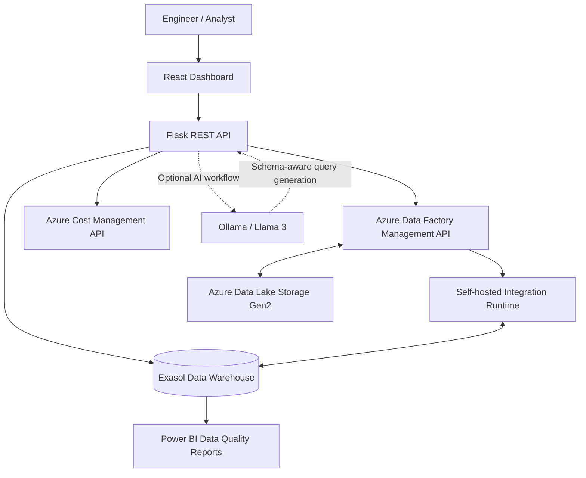

<div align="center">

# OpsNexus

### Data Pipeline Observability · Data Quality Intelligence · AI-Assisted Data Operations

**A unified operations dashboard connecting Azure Data Factory, Exasol, and modern analytics workflows.**


</div>

---

## Overview

**OpsNexus** is a data operations and observability project designed to give engineering and analytics teams one place to inspect data pipelines, investigate failures, evaluate data quality, and understand platform usage.

It brings together **Azure Data Factory (ADF)** pipeline execution metadata, **Exasol** data warehouse operations, a **Flask REST API**, and a **React** dashboard. **Power BI** supports analysis of valid and rejected records. The broader product vision includes natural-language data requests powered by local large language models.

### The problem

Data teams often work across disconnected tools to answer critical operational questions:

- Which pipeline failed, when, and at what activity?
- Are incoming records valid, or were they rejected during ingestion?
- How can engineers inspect warehouse tables without switching tools?
- Is pipeline activity increasing alongside cloud expenditure?
- How can users request data without manually writing SQL?

**OpsNexus brings these workflows into a single operational experience.**

## Key capabilities

| Area | Capabilities |
| --- | --- |
| **Pipeline observability** | View ADF pipeline runs, statuses, start/end times, durations, and execution details. |
| **Failure investigation** | Inspect activity-level diagnostics and surface failed runs through a dashboard alert feed. |
| **Data quality** | Analyze valid and rejected data stored in Exasol and visualize quality outcomes in Power BI. |
| **Warehouse exploration** | Browse Exasol schemas, tables, columns, and records through backend APIs and dashboard views. |
| **Usage and cost insights** | Correlate pipeline run activity with Azure cost data where the necessary billing permissions are configured. |
| **AI-assisted data requests** | Prototype natural-language-to-SQL workflows using local Ollama/Llama 3 with schema-aware constraints. |

> **Implementation note:** OpsNexus is an evolving project. Some capabilities are functional integrations, while others are prototypes or planned product enhancements. See [Project status](#project-status) for details.

## Architecture



### Data flow

1. **Ingest and orchestrate:** ADF pipelines move data between supported sources, Azure storage, and Exasol through configured integration runtimes.
2. **Collect execution metadata:** Flask calls the ADF management API to retrieve pipeline runs and activity diagnostics.
3. **Inspect data:** The backend queries Exasol for warehouse metadata, table content, and quality-related metrics.
4. **Visualize operations:** React presents pipeline activity, failures, warehouse data, and operational metrics.
5. **Analyze quality:** Power BI reports summarize valid and rejected records from the Exasol-backed workflow.
6. **Assist requests:** An experimental local LLM workflow translates constrained natural-language requests into database queries.

## Technology stack

| Layer | Technologies |
| --- | --- |
| Frontend | React, JavaScript, CSS, Lucide icons |
| Backend | Python, Flask, REST APIs |
| Data warehouse | Exasol, SQL, `pyexasol` |
| Orchestration | Azure Data Factory, Self-hosted Integration Runtime |
| Cloud storage | Azure Data Lake Storage Gen2 / Azure Blob Storage |
| Cloud APIs | Azure Resource Manager, Azure Cost Management |
| Authentication | Microsoft Entra ID service principal / Azure Identity SDK |
| Business intelligence | Microsoft Power BI |
| AI experimentation | Ollama, Llama 3, schema-aware SQL generation |
| Development | Git, GitHub, local Exasol deployment |

## Core modules

### 1. Pipeline monitoring

The pipeline dashboard exposes run-level information, including pipeline name, run ID, execution status, start time, end time, and duration. Users can inspect individual runs for deeper activity-level diagnostics.

**Example monitoring endpoints:**

```http
GET /api/adf/pipeline-logs?hours=168&include_activities=true
GET /api/adf/debug-run/{run_id}
```

### 2. Failure alerts

A failure-alert API queries recent ADF executions and returns failed pipeline runs for display in React.

```http
GET /api/adf/failure-alerts?hours=24
```

The dashboard can periodically refresh this feed (for example, every 15 seconds). **Polling is near-real-time, not instantaneous push notification.** Event-driven delivery through an Azure webhook/Event Grid integration is a possible future improvement.

### 3. Data quality analytics

OpsNexus supports workflows in which records are classified into **valid** and **rejected** datasets. Power BI can visualize acceptance rates, rejection trends, category-level issues, and operational data quality KPIs using data made available from Exasol.

Suggested metrics include:

- Total processed, valid, and rejected records
- Validation success rate and rejection rate
- Rejection reasons by category
- Daily ingestion and rejection trends
- Source-wise or pipeline-wise quality comparison

### 4. Exasol explorer

The warehouse module is designed to make schema discovery and table inspection accessible from the application interface. Depending on configured permissions, the backend can retrieve schemas, tables, columns, and selected records.

> Database write operations should be role-restricted, validated, and audited before any production deployment.

### 5. Usage and cost analytics

An Azure-integrated metrics API can combine execution volumes with daily cloud cost information when the service principal has the required access.

```http
GET /api/metrics/usage-billing
```

Cost availability depends on Azure subscription, billing scope, permissions, and API response structure. Cost figures should not be interpreted as exact per-pipeline costs unless an explicit attribution model is implemented.

### 6. AI-assisted data requests (experimental)

An optional Ollama-based workflow uses Exasol schema metadata to help translate user questions into SQL. A safe implementation should enforce schema allowlists, read-only query execution, query limits, and server-side validation. **Generated SQL must not be executed without authorization and validation.**

## Getting started

### Prerequisites

- Python 3.10+ (or the version supported by your backend dependencies)
- Node.js and npm compatible with the React application
- Access to an Azure subscription and Data Factory
- An Exasol instance and valid database credentials
- Azure service principal with the permissions required by the enabled APIs
- Optional: Power BI Desktop and Ollama

### 1. Clone the repository

```bash
git clone https://github.com/<YOUR_USERNAME>/<YOUR_REPOSITORY>.git
cd <YOUR_REPOSITORY>
```

### 2. Configure the backend

The commands below assume the Flask application is inside `backend/`.

```bash
cd backend
python -m venv .venv
```

**Windows PowerShell:**

```powershell
.\.venv\Scripts\Activate.ps1
pip install -r requirements.txt
```

**macOS / Linux:**

```bash
source .venv/bin/activate
pip install -r requirements.txt
```

Create a local `.env` file using the example below. Match the variable names to your actual Flask configuration.

```dotenv
# Azure
TENANT_ID=your-tenant-id
CLIENT_ID=your-application-client-id
CLIENT_SECRET=your-client-secret
SUBSCRIPTION_ID=your-subscription-id
RESOURCE_GROUP=your-resource-group
DATA_FACTORY=your-data-factory-name

# Exasol
EXASOL_HOST=127.0.0.1
EXASOL_PORT=8563
EXASOL_USER=your-exasol-user
EXASOL_PASSWORD=your-exasol-password
EXASOL_SCHEMA=HACKATHON
EXASOL_NOCERTCHECK=false

# Application
FLASK_HOST=127.0.0.1
FLASK_PORT=5000
FRONTEND_URL=http://localhost:5173
```

Start the Flask application using your repository's actual entry point, for example:

```bash
python app.py
```

### 3. Start the frontend

If your React application is nested under `exasol-dashboard/exasol-dashboard/`, use:

```bash
cd ../exasol-dashboard/exasol-dashboard
npm install
npm run dev
```

Open the local URL displayed by the development server (commonly `http://localhost:5173`). Adjust the frontend API base URL if the backend uses another host or port.

### 4. Connect the integrations

1. Confirm that the Flask service principal can read ADF pipeline runs and activity details.
2. Configure Exasol connectivity and test database access.
3. If ADF uses an on-premises/local Exasol instance, verify the Self-hosted Integration Runtime can reach the Exasol host and ODBC driver.
4. Enable Azure Cost Management access only if cost analytics is required.
5. Connect Power BI to the curated valid/rejected datasets using your chosen supported connectivity method.

## API reference

These routes reflect APIs used or discussed during development. **Verify the enabled routes in the checked-in backend before relying on this table.**

| Method | Endpoint | Purpose |
| --- | --- | --- |
| `GET` | `/api/adf/pipeline-logs` | Fetch pipeline execution history |
| `GET` | `/api/adf/debug-run/{run_id}` | Fetch diagnostics for one run |
| `GET` | `/api/adf/failure-alerts` | Retrieve recent failed runs |
| `GET` | `/api/metrics/overview` | Operational overview metrics |
| `GET` | `/api/metrics/pipelines` | Pipeline metrics |
| `GET` | `/api/metrics/trust` | Data trust / quality metrics |
| `GET` | `/api/metrics/cost` | Cost-related metrics |
| `GET` | `/api/metrics/usage-billing` | Usage and billing analysis |
| `GET` | `/api/tables` | List available warehouse tables |
| `POST` | `/api/rag/query` | Experimental AI-assisted query endpoint |

**Example:**

```bash
curl "http://127.0.0.1:5000/api/adf/pipeline-logs?hours=24&include_activities=true"
```

## Suggested repository layout

```text
OpsNexus/
├── backend/
│   ├── app.py
│   ├── requirements.txt
│   └── .env.example
├── exasol-dashboard/
│   └── exasol-dashboard/
│       ├── src/
│       │   ├── components/
│       │   ├── App.jsx
│       │   └── index.css
│       ├── package.json
│       └── ...
├── docs/                   # Recommended: architecture and setup guides
├── screenshots/            # Recommended: dashboard screenshots
├── .gitignore
└── README.md
```

This is a **suggested structure**, not a verified listing of every repository file. Adapt it to the actual codebase.

## Project status

| Workstream | Status |
| --- | --- |
| React operations dashboard | Developed / evolving |
| Flask integration APIs | Developed / evolving |
| ADF pipeline logs and run diagnostics | Integrated in development |
| Exasol schema/table exploration | Integrated in development |
| Valid/rejected data workflows | Implemented in development |
| Power BI quality reporting | Integration workflow in progress |
| Azure usage and billing analytics | Integration/debugging in progress |
| Failed-run dashboard alerts | Polling-based implementation proposed |
| Local LLM / natural-language SQL | Experimental prototype |
| Event-driven alerts, hardened RBAC, audit trail | Roadmap |

## Roadmap

- [ ] Add event-driven pipeline failure notifications
- [ ] Introduce alert acknowledgement, deduplication, and incident history
- [ ] Add pipeline-level SLA tracking and anomaly detection
- [ ] Expand data quality rules, trends, and root-cause reporting
- [ ] Add role-based access control and audited database operations
- [ ] Harden AI-generated SQL with read-only enforcement and approval gates
- [ ] Add automated tests, CI checks, and deployment documentation
- [ ] Publish architecture diagrams and product screenshots

## Security and configuration

**Never commit credentials, Azure client secrets, database passwords, access tokens, or production data.**

Recommended `.gitignore` entries:

```gitignore
.env
.env.*
!.env.example
.venv/
venv/
__pycache__/
*.pyc
node_modules/
dist/
build/
*.log
```

If secrets were previously committed, remove them from the repository history as appropriate and **rotate them immediately**. Keep least-privilege Azure permissions, validate API inputs, protect database write paths, and disable insecure TLS settings in production.

## Screenshots and demo

Add verified screenshots and a short walkthrough once available:

- Pipeline overview and run history
- Failed pipeline alert panel and activity diagnostics
- Exasol schema and table explorer
- Power BI data quality report
- Usage and billing dashboard

<!-- Example once a real screenshot exists:

-->

## Contributing

Contributions and improvement suggestions are welcome. Open an issue to describe a bug or enhancement, then submit a pull request with a clear description of the changes and testing performed.

## License

A license has not been specified in this README. Add a `LICENSE` file and update this section when the project licensing decision is made.

---

<div align="center">

**OpsNexus — From pipeline execution to operational intelligence.**

*Built with React, Flask, Azure Data Factory, Exasol, and Power BI.*

</div>
