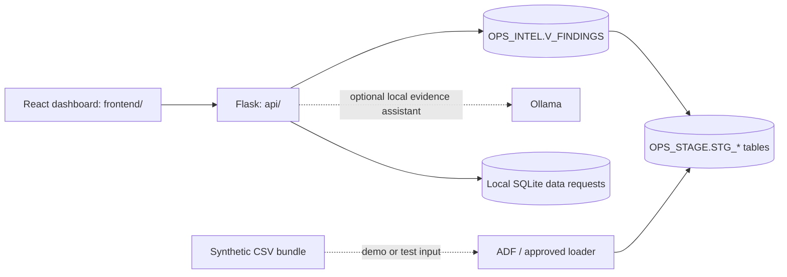

# OpsNexus

OpsNexus is a data operations dashboard and intelligence prototype. It brings
together a React interface, Flask APIs, Exasol data, and synthetic operational
data for exploring pipeline health, data quality, and evidence-backed findings.

> **Implementation status:** the maintained local application is the integrated
> dashboard in `frontend/` served by `api/`. A separate supplied dashboard in
> `exasol-dashboard/` and the legacy `backend/` remain available, but require
> their own configuration. Azure Data Factory (ADF), Azure resources, and
> Power BI are not provisioned by this repository.

## What is included

- **Integrated findings dashboard:** React UI backed by Flask, showing findings
  from the curated Exasol view `OPS_INTEL.V_FINDINGS`.
- **Exasol intelligence rules:** deterministic detection of pipeline failures,
  stale or incomplete data, quality failures, KPI anomalies, cross-domain
  inconsistencies, and incident recurrence.
- **Evidence-backed local assistant:** optional Ollama integration that uses
  curated findings as context; it does not generate or execute SQL.
- **Data requests:** local SQLite workflow records through the integrated API;
  they are not written to Exasol.
- **Synthetic data:** repeatable Module 1 CSV bundles and validation for
  demonstrating and testing the ADF-to-Exasol data contract.
- **Separate dashboard prototype:** `exasol-dashboard/` includes staging,
  ADF, and intelligence screens. Its legacy backend has separate identity and
  configuration requirements.

## Architecture



`OPS_SOURCE` is reserved for optional source/reference data, `OPS_STAGE` holds
operational inputs, and `OPS_INTEL` holds curated analytical views and
intelligence outputs. Ground-truth labels are for offline evaluation only and
must never be loaded as operational data.

## Requirements

- Windows PowerShell for the commands in this guide.
- Python 3.11 or later for the synthetic-data package; use a compatible Python
  version for the Flask dependencies.
- Node.js and npm for frontend build or development.
- The existing local Exasol Personal deployment for live database features.
- Optional: Ollama and a locally installed model for the assistant.

The project uses the existing local Exasol Personal deployment; it does not
provision Exasol or Azure. Exasol Docker DB is not the selected deployment
path. It is an evaluation/testing distribution with platform requirements
(including Linux) and a 10 GiB raw-data limit.

## Quick start: integrated application

Run commands from the repository root.

### 1. Prepare Python

Create a virtual environment if one does not already exist, then install the
synthetic-data package and API dependencies:

```powershell
py -3.11 -m venv .\synthetic-data\.venv
& '.\synthetic-data\.venv\Scripts\python.exe' -m pip install -e .\synthetic-data
& '.\synthetic-data\.venv\Scripts\python.exe' -m pip install -r .\api\requirements.txt
```

If the virtual environment already exists, skip the `venv` command.

### 2. Configure Exasol access

1. Start the existing Exasol Personal deployment with its supported launcher.
   The repository's local run guide uses:

   ```powershell
   & '.\Deployment\exasol.exe' start
   ```

   Use the launcher's `info` command or approved client configuration to
   confirm the current host, port, TLS, and deployment status.
2. Copy `api/.env.example` to the ignored local file `api/.env`.
3. Configure the local host and port, a dedicated **read-only, non-SYS**
   `OPSNEXUS_API` user, and validated TLS. Keep the password in an approved
   secret store or protected local configuration; never put credentials in
   Git, SQL files, URLs, or command history.
4. For a self-signed local Exasol Personal certificate, configure the
   64-character SHA-256 certificate fingerprint in
   `EXASOL_CERTIFICATE_FINGERPRINT`. Otherwise configure CA certificate
   validation. Do not disable certificate validation.

The API identity should have only `CREATE SESSION`, `USAGE ON SCHEMA
OPS_INTEL`, and `SELECT ON VIEW OPS_INTEL.V_FINDINGS`. An administrator can
apply the grants in
[`infra/exasol/sql/04_grant_findings_api_readonly.sql`](infra/exasol/sql/04_grant_findings_api_readonly.sql)
after the account and view exist. The API rejects `SYS`.

### 3. Start the Flask app

```powershell
& '.\synthetic-data\.venv\Scripts\python.exe' -m flask --app api.app run --host 127.0.0.1 --port 5000
```

Open <http://127.0.0.1:5000/>. The service binds to loopback and serves both
the built dashboard and API. It is not authenticated; do not expose the Flask
development server to a network.

### 4. Build or develop the frontend

To rebuild the integrated UI after frontend changes:

```powershell
Set-Location .\frontend
npm install
npm run build
Set-Location ..
```

The build is written to `api/static/`. For hot reload, run `npm run dev` from
`frontend/` while Flask is running; Vite proxies `/api` and `/health` to
`127.0.0.1:5000`.

### Optional: local assistant

Set `OLLAMA_URL` to a loopback Ollama endpoint and `OLLAMA_MODEL` to an
installed local model in `api/.env`. The assistant uses curated finding
evidence only; it does not execute generated SQL. Missing or unreachable
services return an unavailable response.

## Exasol setup and deployment steps

The SQL files define a proposed local Exasol contract; they do not install
Exasol, create Azure resources, or configure ADF.

1. **Confirm the deployment.** Start the existing Exasol Personal instance and
   verify its host, port, version, TLS configuration, and current user using an
   approved client. Keep the database private; the local deployment is not an
   ADF-reachable endpoint by default.
2. **Create schemas.** Review and run
   [`infra/exasol/sql/01_create_schemas.sql`](infra/exasol/sql/01_create_schemas.sql)
   using an authorized administrative identity. It creates `OPS_SOURCE`,
   `OPS_STAGE`, and `OPS_INTEL`.
3. **Create staging tables.** Review and run
   [`infra/exasol/sql/02_create_staging_tables.sql`](infra/exasol/sql/02_create_staging_tables.sql)
   using an authorized identity. It defines 11 `OPS_STAGE.STG_*` tables.
4. **Load operational data.** Use an approved loader or ADF/SHIR design to
   validate and load the 11 operational CSV files described below. Load
   reference entities before dependent runs and observations.
5. **Create the findings view.** After staging data is available, review and
   run [`infra/exasol/sql/03_create_intel_findings.sql`](infra/exasol/sql/03_create_intel_findings.sql)
   as an identity authorized to create or replace the view.
6. **Grant API access.** Create or identify a dedicated read-only API user
   through the approved administrative process, then run
   [`infra/exasol/sql/04_grant_findings_api_readonly.sql`](infra/exasol/sql/04_grant_findings_api_readonly.sql).
   Do not grant the API identity access to raw staging tables or DDL/DML.
7. **Verify.** Check `SELECT CURRENT_TIMESTAMP, CURRENT_USER;`, verify
   `SELECT 1`, confirm the expected view is available, then call `/health` and
   `/api/findings`.

The optional evidence-audit UDF in
[`infra/exasol/sql/05_create_evidence_audit_udf.sql`](infra/exasol/sql/05_create_evidence_audit_udf.sql)
is separate from the dashboard and is not required for normal operation. It
requires explicit deployment approval and an identity authorized to create
scripts; do not use the read-only API identity or a launcher connection that
defaults to `SYS`.

### ADF and Self-Hosted Integration Runtime (SHIR)

ADF is a proposed ingestion boundary, not a component deployed by this
repository. For an ADF connection to local Exasol, the selected SHIR host must
be able to reach the database privately, have the appropriate Exasol ODBC
driver, and validate TLS. `127.0.0.1` on a developer workstation is not a
remote ADF endpoint. Do not expose Exasol publicly; finalize networking,
firewall, routing, DNS, and certificate policy with the platform owner.

Recommended ingestion flow:

1. Validate `manifest.json`, `validation-report.json`, schema version, allowed
   file set, headers, row counts, data types, IDs, and references. Reject a
   bundle when validation fails.
2. Land the immutable bundle in a bundle-specific location. Use
   `(bundle_id, relative file path)` as the ingestion-batch identity and make
   exact replays idempotent.
3. Load reference tables first: sources, pipeline definitions, datasets,
   quality checks, dependencies, and scenario metadata.
4. Load event/measurement tables: pipeline runs, dataset observations,
   quality results, business KPIs, and incident history.
5. Verify counts, schema version, uniqueness, references, and representative
   joins before publishing data to analytical consumers. Do not partially
   publish a failed bundle.

Do **not** load `ground_truth/expected_outcomes.json`. It contains expected
labels for offline tests and demonstrations, not operational evidence.
`manifest.json` and `validation-report.json` are control metadata, not staging
tables. Store passwords only in the approved secret store.

## Synthetic data

The `synthetic-data/` Python package produces deterministic, synthetic
operational records. It makes no Azure calls and requires no cloud credentials.
Schema version is `2.0.0`; the checked-in sample bundle is
`synthetic-data/examples/seed-20261014/`.

Generate and validate the sample bundle from the repository root by changing
into `synthetic-data/` first:

```powershell
Set-Location .\synthetic-data
& '.\.venv\Scripts\python.exe' -m opsnexus_synthetic generate --seed 20261014 --out examples/seed-20261014
& '.\.venv\Scripts\python.exe' -m opsnexus_synthetic validate examples/seed-20261014
Set-Location ..
```

The bundle has 11 operational CSVs:

| File | Staging table |
| --- | --- |
| `data_sources.csv` | `OPS_STAGE.STG_DATA_SOURCES` |
| `pipeline_definitions.csv` | `OPS_STAGE.STG_PIPELINE_DEFINITIONS` |
| `pipeline_runs.csv` | `OPS_STAGE.STG_PIPELINE_RUNS` |
| `datasets.csv` | `OPS_STAGE.STG_DATASETS` |
| `dataset_observations.csv` | `OPS_STAGE.STG_DATASET_OBSERVATIONS` |
| `quality_checks.csv` | `OPS_STAGE.STG_QUALITY_CHECKS` |
| `quality_results.csv` | `OPS_STAGE.STG_QUALITY_RESULTS` |
| `dependencies.csv` | `OPS_STAGE.STG_DEPENDENCIES` |
| `business_kpis.csv` | `OPS_STAGE.STG_BUSINESS_KPIS` |
| `incident_history.csv` | `OPS_STAGE.STG_INCIDENT_HISTORY` |
| `scenario_metadata.csv` | `OPS_STAGE.STG_SCENARIO_METADATA` |

The fixtures cover healthy baseline, pipeline failure, stale data, incomplete
data, metric anomaly, cross-domain inconsistency, recurring incident, and
inconclusive evidence. Operational scenario IDs are opaque; semantic labels
and expected outcomes are isolated in ground truth. Synthetic KPI impact is
illustrative, not measured business loss, and a finding is not proof of root
cause or recovery.

## API and dashboard contracts

The integrated Flask API reads only `OPS_INTEL.V_FINDINGS` for intelligence:

- `GET /health` checks API and database availability.
- `GET /api/findings` returns paginated findings, with optional finding type,
  severity, and opaque scenario filters.
- `GET /api/findings/<finding_id>` returns one finding or `404`.
- `POST /api/rag/query` asks the local evidence assistant, if configured.
- `GET /api/requests` and `POST /api/requests` read and create local workflow
  requests. These are stored in SQLite and do not write to Exasol.

Finding results include stable IDs, finding type and severity, affected entity,
evidence, recommended action, source references, and optional measured,
expected, threshold, run, and scenario values. Missing values are `null`.
Signals and recommendations are evidence for investigation, not confirmed
root causes. Errors are sanitized; raw database exceptions and credentials
are not returned.

Azure billing data is only available when the required Azure permissions and
source data are configured. The current 11-table staging contract contains no
cost-usage table, so cost metrics may report unavailable.

### Separate supplied dashboard

`exasol-dashboard/` is a separate Vite application. Its intelligence screen
uses the curated findings API at port `5001`; its legacy ADF/staging panels use
the separate `backend/` service at port `5000`. Start three services in
separate PowerShell terminals.

1. Create `backend/.env` locally. Use an authorized non-SYS Exasol account,
   keep secrets out of Git, and leave certificate validation enabled:

   ```dotenv
   EXASOL_HOST=127.0.0.1
   EXASOL_PORT=8563
   EXASOL_USER=<approved-non-SYS-user>
   EXASOL_PASSWORD=<secret-from-approved-store>
   EXASOL_SCHEMA=OPS_STAGE
   EXASOL_NOCERTCHECK=false
   FLASK_HOST=127.0.0.1
   FLASK_PORT=5000
   FRONTEND_URL=http://localhost:5173
   AZURE_TENANT_ID=<tenant-id-if-needed>
   AZURE_CLIENT_ID=<service-principal-client-id-if-needed>
   AZURE_CLIENT_SECRET=<secret-from-approved-store>
   AZURE_SUBSCRIPTION_ID=<subscription-id-if-needed>
   AZURE_RESOURCE_GROUP=opsnexus
   AZURE_DATA_FACTORY=opsnexus
   AZURE_MONTHLY_BUDGET_INR=1000
   COST_NORMAL_MAX_INR=10
   COST_ELEVATED_MAX_INR=50
   NORMAL_RUNS_MAX=5
   ELEVATED_RUNS_MAX=20
   ```

   Azure settings are optional unless using Azure features. The budget and
   run-count settings are application thresholds, not credentials. The legacy
   backend reads `backend/.env`; the findings API uses a separate `api/.env`
   and separate identity. Do not copy credentials between them.

2. Install and start the legacy backend from the repository root. The
   dependency file is named `backend/requirement.txt` (singular):

   ```powershell
   py -m venv .\backend\.venv
   & '.\backend\.venv\Scripts\python.exe' -m pip install --upgrade pip
   & '.\backend\.venv\Scripts\python.exe' -m pip install -r .\backend\requirement.txt
   & '.\backend\.venv\Scripts\python.exe' .\backend\app.py
   ```

3. In another terminal, start the read-only findings API from the repository
   root. Configure `api/.env` as described in the integrated quick start:

   ```powershell
   & '.\synthetic-data\.venv\Scripts\python.exe' -m flask --app api.app run --host 127.0.0.1 --port 5001
   ```

4. In a third terminal, start the dashboard:

   ```powershell
   Set-Location .\exasol-dashboard
   npm install
   npm run dev
   ```

Open <http://127.0.0.1:5173/>. The Intelligence Findings screen uses port
`5001`; staging and ADF panels use port `5000`. The legacy backend requires
authorized access to its configured `OPS_STAGE` tables. Do not use `SYS` or
disable certificate validation to work around missing permissions.

## Tests and verification

Run the suites from the repository root. Set `PYTHONPATH` for the
Exasol-contract tests:

```powershell
$env:PYTHONPATH = 'D:\OpsNexus\OpsNexus'
& '.\synthetic-data\.venv\Scripts\python.exe' -m unittest discover -s .\synthetic-data\tests -p 'test_*.py' -v
& '.\synthetic-data\.venv\Scripts\python.exe' -m unittest discover -s .\infra\exasol\tests -p 'test_*.py' -v
& '.\synthetic-data\.venv\Scripts\python.exe' -m unittest discover -s .\api\tests -p 'test_*.py' -v
git diff --check
```

The API and Exasol contract tests use local/mock or offline checks; they do not
require a live database. The live evaluator
`infra/exasol/tests/evaluate_intelligence.py` requires an authorized,
read-only API connection and configured local environment.

## Security and operational boundaries

- Keep Flask bound to `127.0.0.1` for local work. It has no built-in user
  authentication; use an approved authenticated gateway before broader access.
- Use dedicated, least-privilege identities. Never use `SYS` for the API,
  ADF ingestion, or ordinary application access.
- Require TLS certificate validation. Do not use a DSN that disables
  validation.
- Keep secrets out of source control, SQL, URLs, terminal history, and
  screenshots. Use local ignored environment files or an approved secret store.
- Do not expose Exasol publicly or allow arbitrary schema/table browsing or
  SQL execution.
- Keep ground-truth labels separate from operational data.
- A zero-row metadata result may mean the connected identity cannot see a
  table; it does not by itself prove the data is missing.

## Repository map

| Path | Purpose |
| --- | --- |
| `api/` | Maintained Flask findings API and built dashboard assets |
| `frontend/` | Maintained integrated React/Vite dashboard |
| `backend/` | Separate legacy Flask backend for prototype panels |
| `exasol-dashboard/` | Separate supplied React/Vite dashboard |
| `infra/exasol/sql/` | Schema, staging, intelligence, grants, and optional UDF SQL |
| `infra/exasol/tests/` | Offline Exasol contract tests and live evaluator |
| `synthetic-data/` | Deterministic bundle generator, validator, examples, and tests |
| `contracts/` | Shared dashboard API contract |
| `docs/` | Consolidated overview, local run guide, and retained PDF references |

This README is the project entry point. The [docs overview](docs/README.md)
consolidates setup, API, Exasol, synthetic-data, and integration guidance.
See [the local run guide](docs/how%20to%20run.txt) for step-by-step startup
instructions. Use the code, SQL, and shared contracts listed there as the
implementation source of truth.
